  

  <a href="https://5u8han.dev">Website</a>
  &nbsp;&nbsp;/&nbsp;&nbsp;
  <a href="https://www.linkedin.com/in/5u8han">LinkedIn</a>
  &nbsp;&nbsp;/&nbsp;&nbsp;
  <a href="mailto:noeman.subhan@gmail.com">Email</a>

  Jump to:
  <a href="#where-ive-been">Where I've been</a> &nbsp;/&nbsp;
  <a href="#the-road-ahead">The road ahead</a> &nbsp;/&nbsp;
  <a href="#skillboard">Skillboard</a>

## Hey, I'm Subhan

I'm a Support Engineer based in Chicago (you might also know me as **5u8han**). For 7+ years I've been the person who makes technology feel easy: devices that just work, access sorted out before anyone has to ask, and calm, white-glove support for the people who keep a business moving.

Now I'm growing into systems administration across macOS, Windows and Linux, with cloud and hybrid architecture as part of the picture. My home turf is endpoints, identity and access, and the SaaS tools a modern workplace runs on, and I like clear documentation, repeatable processes, and a good script that quietly handles the boring parts.

## Right now

- **Working:** Senior Desktop Support / Support Engineer at Tropicana Brands Group
- **Growing into:** systems administration for macOS, Windows and Linux, including cloud and hybrid
- **Learning:** Java, JavaScript, SQL, Laravel, the Microsoft 365 suite, Docker and Kubernetes
- **Tinkering:** virtualization and homelab setups with Proxmox, VMware and Docker
- **btw:** I use Arch 🐧

## What I do

- **Endpoints and devices.** Zero-touch deployment, imaging, patching and lifecycle management for Windows, macOS and iOS, using Intune, SCCM/MECM, JAMF Pro, AirWatch and FleetDM.
- **Identity and access.** Okta, Azure AD / Entra ID and Active Directory: onboarding and offboarding, SSO, MFA, YubiKey and FIDO2 rollouts, and untangling access issues until signing in is boring again.
- **Workspaces and collaboration.** Microsoft 365, Google Workspace and Slack administration, plus Teams Rooms, Zoom Rooms and AV for meeting spaces.
- **White-glove support.** Discreet, high-touch IT for executives and leadership teams, with a focus on responsiveness and a smooth experience.
- **Documentation.** SOPs and knowledge-base articles that people actually read, so nobody has to ask the same question twice.

## Where I've been

Eight stops, newest first. In each card, the tools from that role drift by in the background.

- On-site and cross-site support across multiple offices, including white-glove support for C-level leaders.
- Windows and macOS troubleshooting, Microsoft 365, Teams, Outlook and SharePoint support, plus Teams Rooms, Zoom Rooms and AV for meeting spaces.
- Endpoint provisioning, onboarding and offboarding, asset tracking, patching and compliance across sites, including Microsoft Surface deployment and inventory in an Intune-managed environment.
- Identity and access in Okta and Google Workspace: MFA setup, password resets and access troubleshooting.

- Triaged and escalated tickets in ServiceNow and Jira as the link between users and engineers, with fixes documented in Confluence.
- Administered Google Workspace, Slack, Okta and Microsoft 365: provisioning, access control and MFA.
- Streamlined macOS and iOS management with JAMF Pro, integrating Apple Business Manager, Okta and FleetDM for zero-touch deployment and compliance tracking.
- Set up and supported YubiKey with FIDO2, OTP and Touch ID, and ran hardware deployment projects that shipped pre-configured devices in large batches for new-hire waves.

- Managed Windows images with SCCM/MECM and PXE boot for zero-touch and batch deployments, with driver packs, BIOS and firmware built into the task sequences for Dell, HP and Lenovo hardware.
- Provisioned endpoints with Intune and VMware AirWatch, supported Active Directory, Azure AD, Exchange and Microsoft 365 (E1, E3, E5), and pushed SCCM reporting into Power BI.
- Ran hardware testing: thermal analysis, benchmarking, crash testing, battery life and feature validation.
- Supported Cisco and Avaya VoIP, Zoom, Webex and AV, monitored servers and switches in SolarWinds, and automated tasks with PowerShell and SQL.

- Tier 2 and 3 desktop support for attorneys and staff in a law-firm environment: Windows 10, macOS, Microsoft 365, imaging, driver conflicts and patching through SCCM.
- Managed user accounts, profiles and policies in Active Directory, Azure AD, Intune and AirWatch.
- Deep Outlook troubleshooting: PST and OST issues, calendar sync, mailbox permissions, shared mailboxes, delegates and iManage integration.
- Supported Avaya SIP phones through Avaya CM, including SIP registration, one-way audio, QoS and VLAN troubleshooting, alongside WLAN, DNS, DHCP, VPN and secure printing.

- First point of contact in ServiceNow and the link between engineers, VPs and clients, with knowledge-base articles kept current.
- Supported Active Directory, Azure AD, Microsoft 365, Google Workspace, Teams, Zoom, Salesforce and DocuSign, and provisioned VMs on ESXi and vSphere.
- Worked across Cisco, Dell, HPE and Supermicro servers, Catalyst switches and Sophos Firewall, with DNS, TCP/IP, DHCP, routing, NAT, VLANs, Wireshark and SolarWinds.
- Watched datacenter health through IPMI, iDRAC and iLO, diagnosed disk, RAM and power supply failures, and handled vendor RMAs.
- Supported VPNs (AnyConnect, OpenVPN, WireGuard, Pulse Secure, Zscaler, JumpCloud), trained teammates with Confluence guides, and supported multi-site migrations in a hybrid cloud architecture.

- Level 2 and 3 support for desktops, laptops, printers, AV, Cisco VoIP, mobile devices and datacenter machines in a hospital environment.
- Provisioned users in Active Directory, Azure AD and Exchange, applied Group Policy, and handled Wi-Fi and SSO access plus mailbox and distribution list permissions.
- Imaged machines with SCCM/MECM and PXE boot, recovered BitLocker, and troubleshot Exchange and Outlook.
- Managed VMs on ESXi and vSphere, watched hardware health with SolarWinds, iDRAC, iLO and IPMI, and supported Citrix XenDesktop and XenApp, Cisco CUCM, AnyConnect, MFA and passwordless sign-in.

- Tier 1, 2 and 3 support, and team lead, at a high-volume MSP serving healthcare, finance and enterprise clients.
- ServiceNow for ticket routing, incident resolution, change management and CMDB, plus knowledge-base articles.
- Identity work in Azure AD, Oracle IAM, SailPoint and Active Directory: provisioning, deprovisioning, group policy and access control.
- Endpoint work with SCCM, VMware Horizon and Intune, Exchange Online and hybrid mailboxes, BitLocker, VPN (AnyConnect, SonicWall), DNS, DHCP and print servers.
- Led and trained a department of tech specialists, monitored queues, and worked with Field Service Onsite teams.

- Planned and built the company's IT environment from the ground up: sizing, procurement and deployment of PCs, laptops, printers, servers, firewalls, switches, SIP phones, cameras and cabling.
- Windows Server 2019 and Active Directory with role-based access and Group Policy, with lab and accounting software integrated into AD.
- A 3CX phone system with Yealink handsets and SIP fax, and a pfSense firewall covering NAT, port forwarding, VPN, segmentation and QoS.
- Led the company website (Drupal on SiteGround) and worked with outside developers on a secure patient and doctor portal, with McAfee endpoint security and vendor penetration testing and remediation for compliance.

## The road ahead

I'm working toward a systems administrator role that covers macOS, Windows and Linux, with cloud and hybrid architecture as one part of a bigger picture: endpoints, servers, identity, networking and automation. Filled dots below are where I've been, rings are where I'm heading. Everything on the right side of the map is a direction, not something I'm claiming yet.

### Accomplishments so far

- Planned and built a company's IT environment from scratch at Chicago Lab Services: network, servers, phones, firewall, cabling and a secure report portal.
- Managed macOS and iOS fleets with JAMF Pro, Apple Business Manager, Okta and FleetDM at Robinhood.
- Ran large-batch hardware deployments for new-hire waves, and built zero-touch Windows deployments with SCCM/MECM and PXE at Illinois DoIT and Endeavour Health.
- Ran hardware testing at Illinois DoIT: thermal analysis, benchmarking, crash testing and battery life.
- Led a service desk team at an MSP, and trained and onboarded teammates at Alter Domus.
- Supported executives and leadership teams at Robinhood and Tropicana.
- Completed a Bachelor's in Computer Science (2020 to 2023) while working in IT, and earned CompTIA A+, Network+ and Security+.

### Happy moments

- Handing a new hire a laptop that just works on day one, with access ready before they ask.
- Replacing an hour of clicking with a script and never thinking about that task again.
- Standing up a whole office, from bare cable runs to a working phone system and domain.
- Tracking a stubborn problem down to its root cause after a long walk through the logs.
- Seeing someone I trained handle a tricky ticket on their own.
- Finishing a Computer Science degree while working in IT.

### Learning moments

- **Documentation is part of the fix.** A good SOP or knowledge-base article saves the next person, and future me, from starting over.
- **Escalate with evidence.** Clear steps, logs and what's already been tried make every handoff faster.
- **Automate the repeatable parts.** Zero-touch deployments and scripts pay for themselves quickly, and they're also where the sharpest edge cases hide.
- **Communication is most of the job.** Leading a team and training others taught me that clear, kind updates beat heroics.
- **Windows feature updates are their own craft.** I'm refining a PowerShell workflow that pins Surface devices to Windows 11 24H2 through local policy. The version lock works, and I'm still iterating on the setup flow around it.

### What I'm building toward

- **macOS:** owning fleet standards end to end, from enrollment and baselines to patch policy and compliance reporting with JAMF Pro, Apple Business Manager and FleetDM.
- **Windows:** Windows Server, Active Directory and Group Policy in production, hybrid identity with Entra ID, and a clear patching strategy across Intune and Configuration Manager.
- **Linux:** server administration on Red Hat and Debian-family systems, covering patching, hardening, backups, monitoring and shell and Python automation, plus containers with Docker and Kubernetes.
- **Cloud and hybrid:** Azure, GCP and Cloudflare alongside on-prem virtualization (ESXi, Hyper-V, Proxmox), with DNS, VPN and VLAN design tying them together.
- **Automation and visibility:** PowerShell, Python and SQL to remove repetitive work, and logs and monitoring (SolarWinds, Logstash, Kibana) to spot problems before users do.
- **Process:** finishing ITIL v4 Foundation.

## Credentials

- **Bachelor's in Computer Science**, Northeastern Illinois University (2020 to 2023)
- **CompTIA** A+, Network+ and Security+
- **ITIL v4 Foundation** (in progress)

## Homelab and side quests

- Deployed HPE ProLiant and Dell PowerEdge servers hosting Docker/LXC containers and VMs across ESXi, Hyper-V, Proxmox and QEMU-KVM, with ZFS and Btrfs for storage.
- Configured Windows Server 2019/2025 environments with Active Directory, domain controllers, DNS, forests and IIS.
- Built and hosted web apps (HTML, CSS and JavaScript) on Nginx and Apache in a full LAMP stack.
- Configured network segmentation with VLAN trunk/access tagging, Cisco Catalyst port security, a Kemp load balancer and DHCP/DNS probing.
- Version control on GitHub: branching, merges, pulls and automated updates.

A couple of repos to poke around in: [JavaDev](https://github.com/5u8han/JavaDev) for Java and [DotNet](https://github.com/5u8han/DotNet) for C# over .NET.

## Skillboard

Everything I work with, grouped so it's easy to scan. The middle column lists other names people search for the same skill, and the last column shows where I've used it. "Core skill" means it's part of my everyday toolkit, "Learning now" means I'm actively building it.

### Operating systems and devices

| Skill | Also searched as | Where I've used it |
| :--- | :--- | :--- |
| Windows 10 and 11 | Win10, Win11 | Tropicana, Illinois DoIT, Kirkland & Ellis |
| Windows Server 2016 to 2025 | Server 2016, 2019, 2022, 2025 | Chicago Lab Services, Homelab |
| macOS | Mac, Apple | Tropicana, Robinhood, Illinois DoIT, Kirkland & Ellis |
| iOS | iPhone | Robinhood, Illinois DoIT, Kirkland & Ellis |
| Android device management | Android MDM | Kirkland & Ellis |
| Linux (RHEL, CentOS, Debian) | Red Hat Enterprise Linux, Unix | Illinois DoIT, Homelab |
| Arch Linux | Arch | Daily driver |
| Microsoft Surface (Laptop 5 and 6, Pro 9) | Surface Laptop, Surface Pro | Tropicana |
| Dell, HP and Lenovo laptops and desktops | OEM hardware | Illinois DoIT |
| Printers and secure printing | print servers, print cards | Kirkland & Ellis, DyoPath, Chicago Lab Services |
| Mobile devices (iOS and Android) | MDM | Illinois DoIT, Kirkland & Ellis |

### Endpoint management and deployment

| Skill | Also searched as | Where I've used it |
| :--- | :--- | :--- |
| Microsoft Intune | Endpoint Manager, MEM, MDM | Tropicana, Illinois DoIT, Kirkland & Ellis, DyoPath |
| SCCM / MECM | Configuration Manager, ConfigMgr, Endpoint Configuration Manager | Illinois DoIT, Kirkland & Ellis, Alter Domus, Endeavour Health, DyoPath |
| PXE boot and task sequences | OSD, operating system deployment | Illinois DoIT, Endeavour Health |
| Driver, BIOS and firmware packaging | Dell Command, HP Image Assistant | Illinois DoIT, Endeavour Health |
| Windows image building | imaging, ISO packaging | Illinois DoIT, Endeavour Health, DyoPath |
| Application packaging and deployment | software deployment | Kirkland & Ellis, Alter Domus, DyoPath |
| VMware AirWatch | Workspace ONE UEM | Illinois DoIT, Kirkland & Ellis |
| JAMF Pro | Jamf, Apple MDM | Robinhood |
| Apple Business Manager | ABM | Robinhood |
| FleetDM | Fleet | Robinhood |
| Zero-touch deployment | automated provisioning | Robinhood, Illinois DoIT, Endeavour Health |
| Large-batch hardware provisioning | new-hire rollouts | Robinhood |
| Device lifecycle and asset tracking | inventory, CMDB | Tropicana, Robinhood, Kirkland & Ellis, Alter Domus |
| Patch management | Windows Update, updates | Tropicana, Kirkland & Ellis, Alter Domus, Chicago Lab Services |
| BigFix | HCL BigFix | Endeavour Health |
| BitLocker | disk encryption, recovery | Endeavour Health, DyoPath |
| FileVault | Mac disk encryption | Core skill |
| Group Policy | GPO | Endeavour Health, DyoPath, Chicago Lab Services |
| Windows 11 feature-update pinning | 24H2 version lock, local policy | Surface fleet (in progress) |
| Hardware testing and validation | benchmarking, thermal testing, crash testing | Illinois DoIT |
| SCCM reporting in Power BI | reporting | Illinois DoIT |

### Identity and access

| Skill | Also searched as | Where I've used it |
| :--- | :--- | :--- |
| Active Directory | AD DS, domain controllers | Illinois DoIT, Kirkland & Ellis, Alter Domus, Endeavour Health, DyoPath, Chicago Lab Services, Homelab |
| Azure AD / Microsoft Entra ID | Entra ID, AAD | Illinois DoIT, Kirkland & Ellis, Alter Domus, Endeavour Health, DyoPath |
| Okta | Okta SSO, Okta MFA, provisioning | Tropicana, Robinhood |
| Single sign-on (SSO) | SSO | Tropicana, Robinhood, Endeavour Health |
| Multi-factor authentication (MFA) | 2FA, MFA | Tropicana, Robinhood, Endeavour Health |
| YubiKey, FIDO2, OTP and Touch ID | hardware security keys | Robinhood |
| Passwordless sign-in | passwordless | Endeavour Health |
| LDAP | directory services | Core skill |
| Oracle IAM | identity management | DyoPath |
| SailPoint | identity governance | DyoPath |
| User provisioning and deprovisioning | onboarding, offboarding | Tropicana, Robinhood, Kirkland & Ellis, DyoPath |
| Role-based access control | RBAC | Chicago Lab Services |
| Mailbox and distribution list permissions | shared mailboxes, delegates | Kirkland & Ellis, Endeavour Health, DyoPath |
| Password resets and access troubleshooting | authentication | Tropicana, Endeavour Health |

### Microsoft 365, Google and collaboration

| Skill | Also searched as | Where I've used it |
| :--- | :--- | :--- |
| Microsoft 365 (E1, E3, E5) | M365, Office 365, O365 | Tropicana, Robinhood, Illinois DoIT, Kirkland & Ellis, Alter Domus |
| Exchange Online and hybrid Exchange | EXO | Illinois DoIT, Endeavour Health, DyoPath |
| Outlook | PST, OST, Autodiscover, calendar sync | Tropicana, Kirkland & Ellis, Endeavour Health, DyoPath |
| Microsoft Teams | Teams | Tropicana, Alter Domus |
| SharePoint and OneDrive | SharePoint Online | Tropicana |
| Google Workspace | G Suite, Google Apps | Tropicana, Robinhood, Alter Domus |
| Slack | Slack administration | Robinhood |
| Zoom | Zoom administration | Illinois DoIT, Alter Domus |
| Zoom Rooms | meeting rooms | Tropicana, Robinhood |
| Microsoft Teams Rooms | Teams Rooms | Tropicana |
| Webex | Cisco Webex | Illinois DoIT |
| Conference room AV | meeting room technology | Tropicana, Robinhood, Illinois DoIT, Kirkland & Ellis |
| Salesforce and DocuSign support | SaaS support | Alter Domus |
| iManage | document management | Kirkland & Ellis |

### Service management, documentation and tools

| Skill | Also searched as | Where I've used it |
| :--- | :--- | :--- |
| ServiceNow | ITSM, incident, change, request | Robinhood, Illinois DoIT, Alter Domus, DyoPath |
| Jira | Atlassian | Robinhood |
| Confluence | knowledge base | Robinhood, Alter Domus |
| KESM ticketing | ticketing | Kirkland & Ellis |
| Knowledge base and SOP writing | documentation, runbooks | Tropicana, Robinhood, Illinois DoIT, Kirkland & Ellis, Alter Domus, Endeavour Health, DyoPath |
| CMDB | configuration management database | Illinois DoIT, Alter Domus, DyoPath |
| Incident, problem and change management | ITIL practices | Robinhood, DyoPath |
| ITIL v4 Foundation | ITIL 4 | In progress |
| Root cause and log analysis | RCA | Robinhood |

### Virtualization, cloud and hybrid

| Skill | Also searched as | Where I've used it |
| :--- | :--- | :--- |
| VMware vSphere and ESXi | VMware, virtual machines | Illinois DoIT, Kirkland & Ellis, Alter Domus, Endeavour Health, Homelab |
| VMware Horizon | VDI | DyoPath |
| Citrix XenDesktop and XenApp | Citrix | Illinois DoIT, Endeavour Health |
| Hyper-V | Microsoft Hyper-V | Homelab |
| Proxmox VE | Proxmox | Homelab |
| QEMU-KVM | KVM | Homelab |
| LXC and Docker containers | Docker, LXC | Homelab, Learning now |
| Kubernetes | K8s | Learning now |
| ZFS and Btrfs | filesystems | Homelab |
| Microsoft Azure | Azure | Core skill |
| Google Cloud Platform | GCP | Core skill |
| Cloudflare Workers and Pages | Cloudflare | Personal projects |
| Hybrid cloud migration | multi-site migration | Alter Domus |
| VM provisioning and resource allocation | virtual machine management | Alter Domus, Endeavour Health |
| Backup software | ShadowBackup | Alter Domus, DyoPath |

### Networking

| Skill | Also searched as | Where I've used it |
| :--- | :--- | :--- |
| TCP/IP | networking fundamentals | Kirkland & Ellis, Alter Domus |
| DNS | Domain Name System | Kirkland & Ellis, Alter Domus, DyoPath, Homelab |
| DHCP | static and dynamic addressing | Kirkland & Ellis, Alter Domus, DyoPath, Homelab |
| VLANs (trunk and access tagging) | 802.1Q | Kirkland & Ellis, Alter Domus, Chicago Lab Services, Homelab |
| Routing and NAT | network address translation | Alter Domus, Chicago Lab Services |
| Wi-Fi and WLAN (access points) | wireless, WAP | Tropicana, Kirkland & Ellis |
| LAN troubleshooting | network troubleshooting | Tropicana, Alter Domus |
| QoS | quality of service | Kirkland & Ellis, Chicago Lab Services |
| SNMP | network monitoring | Kirkland & Ellis |
| Load balancers (Kemp) | Kemp | Kirkland & Ellis, Homelab |
| Cisco Catalyst switches | Cisco switching | Alter Domus, Homelab |
| Cisco Meraki | Meraki | Illinois DoIT |
| pfSense | firewall | Chicago Lab Services |
| Sophos Firewall | Sophos | Alter Domus |
| SonicWall VPN | SonicWall | DyoPath |
| Wireshark | packet capture | Alter Domus |
| SolarWinds | network and server monitoring | Illinois DoIT, Kirkland & Ellis, Alter Domus, Endeavour Health |
| Cisco AnyConnect VPN | AnyConnect | Illinois DoIT, Alter Domus, Endeavour Health, DyoPath |
| OpenVPN | VPN | Illinois DoIT, Alter Domus |
| WireGuard | VPN | Alter Domus |
| Pulse Secure | VPN | Alter Domus |
| Zscaler | secure access | Illinois DoIT, Alter Domus |
| JumpCloud | directory and VPN | Alter Domus |
| Structured cabling (Cat5e and Cat6) | Ethernet termination | Chicago Lab Services |
| PoE switches and gateways | Power over Ethernet | Chicago Lab Services |
| Network segmentation and port security | segmentation | Chicago Lab Services, Homelab |

### Voice and video

| Skill | Also searched as | Where I've used it |
| :--- | :--- | :--- |
| Cisco CUCM | Cisco Unified Communications Manager, Call Manager | Alter Domus, Endeavour Health |
| Cisco desk phones | Cisco VoIP | Illinois DoIT, Alter Domus, Endeavour Health |
| Cisco X series video | video conferencing | Illinois DoIT |
| Avaya Communication Manager and SIP phones | Avaya CM | Kirkland & Ellis, Illinois DoIT |
| 3CX phone system | 3CX | Chicago Lab Services |
| Yealink handsets | Yealink | Chicago Lab Services |
| SIP troubleshooting | registration, one-way audio | Kirkland & Ellis |
| SIP fax | fax over IP | Chicago Lab Services |

### Servers and datacenter

| Skill | Also searched as | Where I've used it |
| :--- | :--- | :--- |
| Server hardware (Cisco, Dell, HPE, Supermicro) | rack servers | Alter Domus |
| HPE ProLiant and Dell PowerEdge | server deployment | Homelab |
| IPMI, iDRAC and iLO | out-of-band management | Alter Domus, Endeavour Health |
| Hardware diagnostics (disk, RAM, power supply) and RMA | hardware failure diagnosis | Alter Domus |
| Firmware and patch updates | firmware management | Alter Domus, Chicago Lab Services |
| Rack, stack and cabling | datacenter installation | Chicago Lab Services |
| IIS | Internet Information Services | Homelab |
| Nginx and Apache | LAMP stack, web servers | Homelab |
| Print servers | print queues | DyoPath, Chicago Lab Services |

### Security and compliance

| Skill | Also searched as | Where I've used it |
| :--- | :--- | :--- |
| McAfee Endpoint Security | McAfee | Illinois DoIT, Chicago Lab Services |
| Endpoint compliance tracking | compliance enforcement | Tropicana, Robinhood, DyoPath |
| Security policy enforcement | Active Directory, Azure AD, Intune, AirWatch policies | Kirkland & Ellis |
| HIPAA and state healthcare compliance | HIPAA | Chicago Lab Services |
| Penetration test remediation | vulnerability remediation | Chicago Lab Services |
| CompTIA Security+ | Security Plus | Certification |
| Discretion with confidential information | executive and legal environments | Tropicana, Robinhood, Kirkland & Ellis |

### Scripting, development and web

| Skill | Also searched as | Where I've used it |
| :--- | :--- | :--- |
| PowerShell | Windows automation | Illinois DoIT, Surface scripting |
| SQL | database queries | Illinois DoIT |
| Python | scripting | Core skill |
| C# and ASP.NET | .NET, DotNet | Core skill |
| Java | Java development | Core skill, Learning now |
| JavaScript | JS | Core skill, Learning now |
| HTML and CSS | front-end | Core skill |
| C and C++ | systems programming | Core skill |
| Laravel | PHP framework | Learning now |
| PyQt | Qt for Python | Core skill |
| Arduino | embedded, electronics | Core skill |
| Git and GitHub | version control | Homelab |
| Drupal | CMS | Chicago Lab Services |
| Logstash and Kibana | ELK stack | Core skill |
| Photoshop | Adobe Photoshop | Core skill |

### Support, leadership and process

| Skill | Also searched as | Where I've used it |
| :--- | :--- | :--- |
| Tier 1, 2 and 3 support | help desk, service desk, desktop support | Illinois DoIT, Kirkland & Ellis, Endeavour Health, DyoPath |
| White-glove executive support | VIP, C-level support | Tropicana, Robinhood, Kirkland & Ellis |
| Remote and on-site support | desk-side support | Every role |
| Team leadership and training | team lead, mentoring, onboarding | DyoPath, Alter Domus |
| Cross-team collaboration and escalation | stakeholder communication | Tropicana, Robinhood, Illinois DoIT |
| Vendor and RMA coordination | vendor management | Illinois DoIT, Alter Domus |
| Procurement and sizing | hardware purchasing | Chicago Lab Services |
| Multi-site deployment projects | rollouts | Tropicana, Robinhood, Illinois DoIT, Alter Domus |
| Release and change management | change control | Robinhood |
| Weekly and management reporting | reporting | Illinois DoIT, Endeavour Health |

### Industries

| Skill | Also searched as | Where I've used it |
| :--- | :--- | :--- |
| Financial services | fintech, asset management | Robinhood, Alter Domus |
| Legal | law firm | Kirkland & Ellis |
| Healthcare | hospital, lab | Endeavour Health, DyoPath, Chicago Lab Services |
| Public sector | state government | Illinois DoIT |
| Consumer goods | food and beverage | Tropicana |
| Managed service provider (MSP) | MSP | DyoPath |

### Certifications and education

| Skill | Also searched as | Where I've used it |
| :--- | :--- | :--- |
| CompTIA A+ | A Plus | Certification |
| CompTIA Network+ | Network Plus | Certification |
| CompTIA Security+ | Security Plus | Certification |
| ITIL v4 Foundation | ITIL 4 | In progress |
| Bachelor's in Computer Science | BS Computer Science, Northeastern Illinois University | 2020 to 2023 |

### Skill index

Plain-text index of every skill above (for search)

 

Windows 10 and 11, Win10, Win11, Windows Server 2016 to 2025, Server 2016, 2019, 2022, 2025, macOS, Mac, Apple, iOS, iPhone, Android device management, Android MDM, Linux (RHEL, CentOS, Debian), Red Hat Enterprise Linux, Unix, Arch Linux, Arch, Microsoft Surface (Laptop 5 and 6, Pro 9), Surface Laptop, Surface Pro, Dell, HP and Lenovo laptops and desktops, OEM hardware, Printers and secure printing, print servers, print cards, Mobile devices (iOS and Android), MDM, Microsoft Intune, Endpoint Manager, MEM, SCCM / MECM, Configuration Manager, ConfigMgr, Endpoint Configuration Manager, PXE boot and task sequences, OSD, operating system deployment, Driver, BIOS and firmware packaging, Dell Command, HP Image Assistant, Windows image building, imaging, ISO packaging, Application packaging and deployment, software deployment, VMware AirWatch, Workspace ONE UEM, JAMF Pro, Jamf, Apple MDM, Apple Business Manager, ABM, FleetDM, Fleet, Zero-touch deployment, automated provisioning, Large-batch hardware provisioning, new-hire rollouts, Device lifecycle and asset tracking, inventory, CMDB, Patch management, Windows Update, updates, BigFix, HCL BigFix, BitLocker, disk encryption, recovery, FileVault, Mac disk encryption, Group Policy, GPO, Windows 11 feature-update pinning, 24H2 version lock, local policy, Hardware testing and validation, benchmarking, thermal testing, crash testing, SCCM reporting in Power BI, reporting, Active Directory, AD DS, domain controllers, Azure AD / Microsoft Entra ID, Entra ID, AAD, Okta, Okta SSO, Okta MFA, provisioning, Single sign-on (SSO), SSO, Multi-factor authentication (MFA), 2FA, MFA, YubiKey, FIDO2, OTP and Touch ID, hardware security keys, Passwordless sign-in, passwordless, LDAP, directory services, Oracle IAM, identity management, SailPoint, identity governance, User provisioning and deprovisioning, onboarding, offboarding, Role-based access control, RBAC, Mailbox and distribution list permissions, shared mailboxes, delegates, Password resets and access troubleshooting, authentication, Microsoft 365 (E1, E3, E5), M365, Office 365, O365, Exchange Online and hybrid Exchange, EXO, Outlook, PST, OST, Autodiscover, calendar sync, Microsoft Teams, Teams, SharePoint and OneDrive, SharePoint Online, Google Workspace, G Suite, Google Apps, Slack, Slack administration, Zoom, Zoom administration, Zoom Rooms, meeting rooms, Microsoft Teams Rooms, Teams Rooms, Webex, Cisco Webex, Conference room AV, meeting room technology, Salesforce and DocuSign support, SaaS support, iManage, document management, ServiceNow, ITSM, incident, change, request, Jira, Atlassian, Confluence, knowledge base, KESM ticketing, ticketing, Knowledge base and SOP writing, documentation, runbooks, configuration management database, Incident, problem and change management, ITIL practices, ITIL v4 Foundation, ITIL 4, Root cause and log analysis, RCA, VMware vSphere and ESXi, VMware, virtual machines, VMware Horizon, VDI, Citrix XenDesktop and XenApp, Citrix, Hyper-V, Microsoft Hyper-V, Proxmox VE, Proxmox, QEMU-KVM, KVM, LXC and Docker containers, Docker, LXC, Kubernetes, K8s, ZFS and Btrfs, filesystems, Microsoft Azure, Azure, Google Cloud Platform, GCP, Cloudflare Workers and Pages, Cloudflare, Hybrid cloud migration, multi-site migration, VM provisioning and resource allocation, virtual machine management, Backup software, ShadowBackup, TCP/IP, networking fundamentals, DNS, Domain Name System, DHCP, static and dynamic addressing, VLANs (trunk and access tagging), 802.1Q, Routing and NAT, network address translation, Wi-Fi and WLAN (access points), wireless, WAP, LAN troubleshooting, network troubleshooting, QoS, quality of service, SNMP, network monitoring, Load balancers (Kemp), Kemp, Cisco Catalyst switches, Cisco switching, Cisco Meraki, Meraki, pfSense, firewall, Sophos Firewall, Sophos, SonicWall VPN, SonicWall, Wireshark, packet capture, SolarWinds, network and server monitoring, Cisco AnyConnect VPN, AnyConnect, OpenVPN, VPN, WireGuard, Pulse Secure, Zscaler, secure access, JumpCloud, directory and VPN, Structured cabling (Cat5e and Cat6), Ethernet termination, PoE switches and gateways, Power over Ethernet, Network segmentation and port security, segmentation, Cisco CUCM, Cisco Unified Communications Manager, Call Manager, Cisco desk phones, Cisco VoIP, Cisco X series video, video conferencing, Avaya Communication Manager and SIP phones, Avaya CM, 3CX phone system, 3CX, Yealink handsets, Yealink, SIP troubleshooting, registration, one-way audio, SIP fax, fax over IP, Server hardware (Cisco, Dell, HPE, Supermicro), rack servers, HPE ProLiant and Dell PowerEdge, server deployment, IPMI, iDRAC and iLO, out-of-band management, Hardware diagnostics (disk, RAM, power supply) and RMA, hardware failure diagnosis, Firmware and patch updates, firmware management, Rack, stack and cabling, datacenter installation, IIS, Internet Information Services, Nginx and Apache, LAMP stack, web servers, print queues, McAfee Endpoint Security, McAfee, Endpoint compliance tracking, compliance enforcement, Security policy enforcement, Azure AD, Intune, AirWatch policies, HIPAA and state healthcare compliance, HIPAA, Penetration test remediation, vulnerability remediation, CompTIA Security+, Security Plus, Discretion with confidential information, executive and legal environments, PowerShell, Windows automation, SQL, database queries, Python, scripting, C# and ASP.NET, .NET, DotNet, Java, Java development, JavaScript, JS, HTML and CSS, front-end, C and C++, systems programming, Laravel, PHP framework, PyQt, Qt for Python, Arduino, embedded, electronics, Git and GitHub, version control, Drupal, CMS, Logstash and Kibana, ELK stack, Photoshop, Adobe Photoshop, Tier 1, 2 and 3 support, help desk, service desk, desktop support, White-glove executive support, VIP, C-level support, Remote and on-site support, desk-side support, Team leadership and training, team lead, mentoring, Cross-team collaboration and escalation, stakeholder communication, Vendor and RMA coordination, vendor management, Procurement and sizing, hardware purchasing, Multi-site deployment projects, rollouts, Release and change management, change control, Weekly and management reporting, Financial services, fintech, asset management, Legal, law firm, Healthcare, hospital, lab, Public sector, state government, Consumer goods, food and beverage, Managed service provider (MSP), MSP, CompTIA A+, A Plus, CompTIA Network+, Network Plus, Bachelor's in Computer Science, BS Computer Science, Northeastern Illinois University

## Say hi

Always up for a chat about endpoint management, identity, homelabs, or what's worth learning next.

[Website](https://5u8han.dev) &nbsp;/&nbsp; [LinkedIn](https://www.linkedin.com/in/5u8han) &nbsp;/&nbsp; [Email](mailto:noeman.subhan@gmail.com)

 

  

  Brand logos shown in the role cards are trademarks of their respective owners and appear only to show the tools I work with.

