

  

  <a href="https://5u8han.dev">Website</a>
  &nbsp;&nbsp;/&nbsp;&nbsp;
  <a href="https://www.linkedin.com/in/5u8han">LinkedIn</a>
  &nbsp;&nbsp;/&nbsp;&nbsp;
  <a href="https://twitter.com/5u8han">Twitter / X</a>
  &nbsp;&nbsp;/&nbsp;&nbsp;
  <a href="mailto:info@5u8han.dev">Email</a>

## Hey, I'm Subhan

Support Engineer in Chicago (you might also know me as **5u8han**) with 7+ years of keeping devices, identities and people connected: endpoints, identity and access, collaboration tools and calm, white-glove support. Now I'm growing into systems administration across macOS, Windows and Linux, with cloud and hybrid architecture in the picture.

  &nbsp;&nbsp;&nbsp;&nbsp;&nbsp;&nbsp;&nbsp;&nbsp;&nbsp;&nbsp;&nbsp;&nbsp;&nbsp;&nbsp;&nbsp;&nbsp;&nbsp;&nbsp;&nbsp;&nbsp;&nbsp;&nbsp;&nbsp;&nbsp;

- **Working:** Senior Desktop Support / Support Engineer at Tropicana Brands Group (contract)
- **Learning:** Java, JavaScript, SQL, Laravel, Docker, Kubernetes and the Microsoft 365 suite
- **btw:** I use Arch 

## Where I've been

Newest first. The five most recent are contract roles, and the tools from each one drift by in the background.









## The road ahead

Heading toward systems administration across macOS, Windows and Linux, with cloud and hybrid architecture as part of the picture. Filled dots are where I've been, rings are what's next.


<table>
  <tr>
    <th align="left">Accomplishments</th>
    <th align="left">Happy moments</th>
    <th align="left">Learning moments</th>
  </tr>
  <tr valign="top">
    <td>
      <ul>
        <li>Built a company's IT from scratch at Chicago Lab Services</li>
        <li>Ran macOS and iOS fleets with JAMF Pro, ABM, Okta and FleetDM</li>
        <li>Built zero-touch Windows deployments and ran large-batch hardware rollouts</li>
        <li>Led a service desk team at an MSP</li>
      </ul>
    </td>
    <td>
      <ul>
        <li>A new hire's laptop that just works on day one</li>
        <li>A script that replaces an hour of clicking</li>
        <li>Standing up a whole office, from cable runs to phones</li>
        <li>Tracking a stubborn problem to its root cause</li>
      </ul>
    </td>
    <td>
      <ul>
        <li>Documentation is part of the fix</li>
        <li>Escalate with evidence</li>
        <li>Automate the repeatable parts</li>
        <li>Communication is most of the job</li>
      </ul>
    </td>
  </tr>
</table>

## The home lab, in motion

The home page of my website project, Signal Room, opens on an illustrated version of my home lab. Something breaks, and the character at the desk, a stylized me, reads the alert, traces it from the console, fixes the right rack, checks the result and heads back.

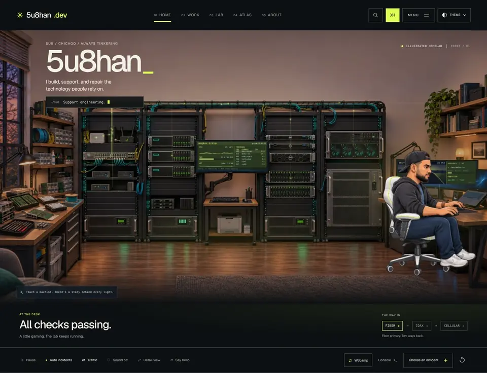

One storage drive failure, sped up 2×. Ten repair stories play out on the page, from failed drives and power supplies to network failover, upgrades and power outages. It's an illustrated simulation, not live telemetry, and the hardware is a sketch rather than an exact inventory.

## Skillboard

Everything I work with, grouped for scanning.

| Area | Skills |
| :--- | :--- |
| **Operating systems and devices**     | Windows 10 and 11, Windows Server 2016 to 2025, macOS, iOS, Android device management, Linux (RHEL, CentOS, Debian), Arch Linux, Microsoft Surface (Laptop 5 and 6, Pro 9), Dell, HP and Lenovo hardware, printers and secure printing |
| **Endpoint management and deployment** | Microsoft Intune, SCCM / MECM (ConfigMgr), PXE boot and task sequences, driver, BIOS and firmware packaging, Windows image building, application packaging, VMware AirWatch (Workspace ONE UEM), JAMF Pro, Apple Business Manager, FleetDM, zero-touch deployment, large-batch provisioning, device lifecycle and asset tracking, patch management, BigFix, BitLocker, FileVault, Group Policy (GPO), hardware testing, Power BI reporting |
| **Identity and access**  | Active Directory, Azure AD (Microsoft Entra ID), Okta, SSO, MFA, YubiKey and FIDO2, OTP and Touch ID, passwordless sign-in, LDAP, Oracle IAM, SailPoint, user provisioning and deprovisioning, role-based access control, mailbox and distribution list permissions |
| **Microsoft 365, Google and collaboration** | Microsoft 365 (E1, E3, E5), Exchange Online and hybrid Exchange, Outlook, Teams, SharePoint and OneDrive, Google Workspace, Slack, Zoom and Zoom Rooms, Microsoft Teams Rooms, Webex, conference room AV, Salesforce and DocuSign support, iManage |
| **Service management and documentation** | ServiceNow (incident, change, request, CMDB), Jira, Confluence, knowledge base and SOP writing, incident, problem and change management, release management, root cause and log analysis, ITIL v4 (in progress), management reporting |
| **Virtualization, cloud and hybrid**      | VMware vSphere and ESXi, VMware Horizon, Citrix XenDesktop and XenApp, Hyper-V, Proxmox VE, QEMU-KVM, LXC and Docker, Kubernetes (learning), ZFS and Btrfs, Microsoft Azure, Google Cloud Platform, Cloudflare Workers and Pages, hybrid cloud migration, VM provisioning, backup software |
| **Networking, voice and video**  | TCP/IP, DNS, DHCP, VLANs, routing and NAT, Wi-Fi, QoS, SNMP, load balancers (Kemp), Cisco Catalyst and Meraki, pfSense, Sophos Firewall, SonicWall, Wireshark, SolarWinds, VPN (Cisco AnyConnect, OpenVPN, WireGuard, Pulse Secure, Zscaler, JumpCloud), structured cabling (Cat5e, Cat6), PoE, network segmentation, Cisco CUCM and desk phones, Avaya CM and SIP phones, 3CX, Yealink, SIP troubleshooting and fax |
| **Servers, security and compliance** | Server hardware (Cisco, Dell, HPE, Supermicro), HPE ProLiant and Dell PowerEdge, IPMI, iDRAC and iLO, hardware diagnostics and RMA, firmware updates, rack and stack, IIS, Nginx and Apache (LAMP), print servers, McAfee Endpoint Security, endpoint compliance, security policy enforcement, healthcare compliance support (HIPAA, state), penetration test remediation, discretion with confidential information |
| **Scripting, development and web**   | PowerShell, SQL, Python, C# and ASP.NET, Java, JavaScript, HTML and CSS, C and C++, Laravel (learning), PyQt, Arduino, Git and GitHub, Drupal, Logstash and Kibana, Photoshop |
| **Support, leadership and industries** | Tier 1, 2 and 3 support, white-glove executive support, remote and on-site support, team leadership and training, cross-team collaboration and escalation, vendor and RMA coordination, procurement and sizing, multi-site deployment projects. Industries: financial services, legal, healthcare, public sector, consumer goods, managed service provider (MSP) |

**Credentials:** CompTIA A+, Network+ and Security+; ITIL v4 Foundation (in progress); Bachelor's in Computer Science, Northeastern Illinois University (2020 to 2023).

  

  Brand logos are trademarks of their respective owners and appear only to show the tools I work with.

